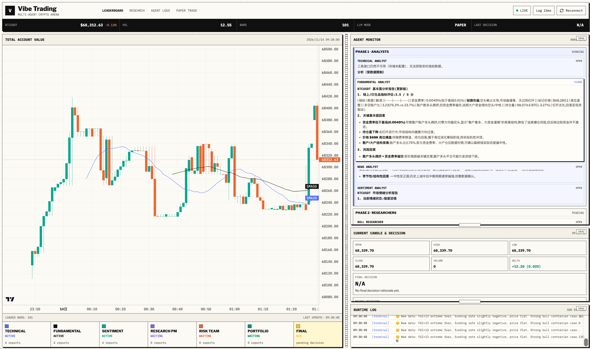

# Vibe Trading

基于大语言模型的多 Agent 协作加密货币量化交易系统。



## 🔧 Agent 内核：zenagent

本项目已从 `pi-py` 迁移到 **[zenagent](https://github.com/encyc/zen-agent)** —— 一个纯 Python、
零重依赖（仅 `httpx`）、可读可改的 agent kernel。

选它的理由很直接：

- **一个晚上能读完**。六层依赖只向下，`agent/loop.py` 是纯函数式的执行器，
  `Agent` 只是它上面的状态包装。
- **没有 vendor lock-in**。`openai-completions` / `anthropic-messages` /
  `google-generative-ai` / `openai-responses` 四个协议适配器，外加一份带定价和
  上下文窗口的模型 catalog。
- **可嵌入**。`Agent(model=..., tools=..., api_key=...)` 加一个 `subscribe` 回调就是全部，
  不用把它的 CLI、会话、权限层一起拖进来。本项目只用了 kernel 的四层，
  封装在 [`backend/src/vibe_trading/runtime/`](./backend/src/vibe_trading/runtime/)。

> ⭐ 如果这个内核对你也有用，去给 **[github.com/encyc/zen-agent](https://github.com/encyc/zen-agent)**
> 点个 star —— 一个人维护的小内核，star 是它被看见的主要方式。

本项目的接入细节与迁移踩坑清单见 [`docs/zenagent_kernel.md`](./docs/zenagent_kernel.md)。

## ✨ 核心特性

- **🤖 12 Agent 协作决策**: 4阶段层级协作，从市场分析到交易执行
- **🎭 智能辩论系统**: 看涨/看跌研究员多轮辩论，论点自动提取和量化裁决
- **🧠 BM25 记忆系统**: 从历史交易经验中学习，持续优化
- **📊 Binance 深度集成**: 支持永续合约交易，实时 K线订阅
- **🎯 Paper Trading**: 模拟交易模式，零风险验证策略
- **🌐 Web 实时监控**: 可视化界面实时展示决策过程
- **⚡ 智能风控**: VaR计算、凯利公式、波动率调整

## 🏗️ 系统架构

系统采用4阶段协作架构：

1. **Phase 1 - 分析师团队**: 技术、基本面、新闻、情绪分析（并行执行）
2. **Phase 2 - 研究员团队**: 看涨/看跌研究员辩论 → 研究经理裁决
3. **Phase 3 - 风控团队**: 激进、中立、保守三视角风险评估
4. **Phase 4 - 决策层**: 交易员制定计划 → 投资组合经理最终决策

详见：[系统架构文档](./docs/ARCHITECTURE.md) | [协作流程详解](./docs/WORKFLOW.md)

## 🧵 多线程架构

- **宏观线程**: 每小时分析大环境（趋势、情绪、重大事件）
- **On Bar线程**: K线触发的3阶段决策流程
- **事件驱动线程**: 实时监控紧急事件，秒级响应

详见：[多线程架构详解](./docs/MULTI_THREAD.md)

## 📦 安装

```bash
uv pip install -e .
```

依赖 [`zenagent-py`](https://pypi.org/project/zenagent-py/)（纯 Python agent kernel，只依赖 `httpx`）会自动从 PyPI 安装。

## ⚙️ 配置

1. 复制配置文件：

```bash
cp backend/.env.example backend/.env
```

2. 配置API密钥（在 `.env` 文件中）：

```bash
BINANCE_TESTNET_API_KEY=your_key
BINANCE_TESTNET_API_SECRET=your_secret
LLM_MODEL=glm_5_3_flash   # 默认模型，可选值见 llm.yaml
```

3. 配置 LLM：复制 `backend/src/vibe_trading/config/llm.yaml.example` 为 `llm.yaml`，
   在里面选模型（`provider` + `model`），技术参数从 zenagent catalog 自动继承。
   API key 不写在 yaml 里 —— 放在 `~/.zenagent/settings.json` 或环境变量中。

## 🚀 使用

### Paper Trading（纸面交易）

```bash
PYTHONPATH=backend/src uv run -- vibe-trade start BTCUSDT
```

### 实盘交易（仅打印订单）

```bash
PYTHONPATH=backend/src uv run -- vibe-trade start BTCUSDT --mode live
```

### Prime Agent 监控模式

```bash
PYTHONPATH=backend/src uv run -- vibe-trade prime BTCUSDT
```


## 📁 项目结构

```
vibe-trading/
├── backend/
│   └── src/
│       ├── vibe_trading/       # 主应用
│       │   ├── agents/         # Agent实现
│       │   ├── coordinator/    # 交易协调器
│       │   ├── data_sources/   # 数据源
│       │   ├── threads/        # 线程实现
│       │   ├── tools/          # 交易工具
│       │   ├── prime/          # Prime Agent监控
│       │   └── config/         # 配置（含 llm.yaml / llm_config.py）
│       └── pi_logger/         # 日志系统
├── docs/                      # 文档
└── pyproject.toml             # zenagent-py 从 PyPI 安装
```

> Agent 运行时由 PyPI 包 [`zenagent-py`](https://pypi.org/project/zenagent-py/) 提供。项目自己的封装在 `src/vibe_trading/runtime/`，是唯一 import `zenagent` 的地方——换内核只需改这个包。

## 🧪 测试

```bash
# 运行所有测试
uv run pytest

# 运行特定测试
uv run pytest tests/test_technical_analysis.py

# 运行Web监控
uv run test_historical.py  # 访问 http://localhost:8000
```

## 🔧 高级功能

### Agent Tools

23个工具按角色分配：

- 技术分析工具（9个）：指标、趋势、支撑阻力、K线形态
- 基本面工具（5个）：资金费率、多空比、持仓量
- 情绪分析工具（3个）：恐惧贪婪指数、新闻情绪
- 风险数据工具（4个）：清算订单、持仓量
- 市场数据工具（2个）：当前价格、24h行情

详见：[Agent工具文档](./docs/TOOLS.md) | [Agent详解](./docs/AGENTS.md)

### Trigger机制

可扩展的事件触发系统：

- 价格Trigger：暴跌、暴涨、突破关键位
- 风控Trigger：VaR超标、连续亏损、保证金不足
- 用户可自定义Trigger

### 模型配置

在 `backend/src/vibe_trading/config/llm.yaml` 中定义所有可用模型（OpenAI / Anthropic / 各类 OpenAI 兼容端点），通过 `use_llm:` 或环境变量 `LLM_MODEL` 选择默认模型。模型加载逻辑在 `llm_config.py`，api_key 在运行时注入 Agent。

## 📖 详细文档

| 文档                               | 说明                            |
| :--------------------------------- | :------------------------------ |
| [系统架构](./docs/ARCHITECTURE.md)    | 整体架构、组件说明、数据流      |
| [Agent详解](./docs/AGENTS.md)         | 12个Agent的功能、工具、协作方式 |
| [多线程架构](./docs/MULTI_THREAD.md)  | 三线程系统详解                  |
| [协作流程](./docs/WORKFLOW.md)        | 阶段间数据传递和消息机制        |
| [Agent工具](./docs/TOOLS.md)          | 23个工具的详细说明              |
| [风险管理](./docs/RISK_MANAGEMENT.md) | 4层约束系统、风控指标           |
| [性能指标](./docs/PERFORMANCE.md)     | 性能测试、优化历史              |
| [改进历史](./docs/IMPROVEMENTS.md)    | 版本历史和未来规划              |

## 📚 灵感来源

本项目从以下项目汲取灵感：

- [TradeAgents](https://github.com/TauricResearch/TradingAgents) - Agent协作架构
- [pi](https://github.com/earendil-works/pi) - 原生 TS Agent 框架
- [zen-agent](https://github.com/encyc/zen-agent) - 纯 Python agent kernel（本项目通过 PyPI 包 `zenagent-py` 使用）

## ⚠️ 免责声明

本系统仅供学习和研究使用。加密货币交易具有高风险，过去的表现不代表未来的收益。使用本系统进行实盘交易的所有风险由使用者自行承担。

## 📄 许可证

MIT License

## Star History

<a href="https://www.star-history.com/?repos=encyc%2Fvibe-trading&type=date&legend=top-left">
 <picture>
   <source media="(prefers-color-scheme: dark)" srcset="https://api.star-history.com/chart?repos=encyc/vibe-trading&type=date&theme=dark&legend=top-left" />
   <source media="(prefers-color-scheme: light)" srcset="https://api.star-history.com/chart?repos=encyc/vibe-trading&type=date&legend=top-left" />
   
 </picture>
</a>
